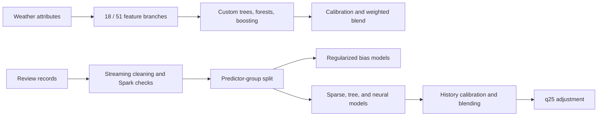

# BigDataComputeProject

**Weather classification and large-scale review rating prediction**, built as a team project spanning custom machine learning, streaming data preparation, Spark validation, and CPU/GPU modeling.

Repository: [BigDataComputeProject](https://github.com/ZHEN-GING/BigDataComputeProject)

The engineering work connects two scales of prediction:

- **Weather classification:** custom tree ensembles and feature engineering for 9,900 labelled records and four classes.
- **Review rating prediction:** audited preparation of 7,684,645 training records, grouped validation, interpretable bias models, and advanced text/tree ensembles.

This public showcase presents the architecture, historical results and individual contributions. Full source code, training notebooks, datasets and model artifacts remain private.

## Architecture

## Results at a glance

These are **historical report values**. Leaderboard scores have not been independently checked during portfolio preparation.

| Task | Reported result | Evaluation boundary |
| --- | --- | --- |
| Weather classification | Public Macro-F1 **0.92456** | No verified Private score; dataset-specific boundaries and repeated leaderboard tuning limit generalization. |
| Review rating prediction | Bias holdout RMSE **1.477608**; advanced team ensemble + q25 Public/Private RMSE **0.53709 / 0.54560** | Grouped holdout and advanced five-fold OOF are different protocols; q25 has no OOF measurement and assumes label noise. |

See [detailed results](docs/RESULTS.md) for all model stages, validation protocols, and limitations.

## Engineering highlights

### Weather classification

- Handcrafted 18-feature base branch and 51-feature engineered branch from 10 raw attributes.
- Custom CART, random forests with Gini/entropy criteria, and gradient/Hessian-based multiclass boosting.
- Partition-aware calibration and a final extended-branch blend with weights 0.45, 0.35, and 0.20.
- Historical development-set five-fold CV and holdout results documented separately from full-training OOF/ablation tables.

The task predicts weather classes; it does not establish a deployed weather forecasting service.

### Review rating prediction

- Streaming typed cleaning followed by Spark aggregate quality checks.
- Stable predictor-group SHA256 keys keep duplicate predictor groups out of opposing train/validation partitions.
- Users and products may still appear on both sides of the split.
- Sequential regularized parent/user bias models provide an interpretable baseline without text features.
- Advanced work adds sparse features, LightGBM, Word/BPE TextCNN, history calibration, and a compact Transformer blend.

The advanced final score is a **team result**. [Contributions](docs/CONTRIBUTIONS.md) separates the data/bias pipeline from later ensemble development.

## Zhen Xu's contribution

Built the streaming data and Spark validation foundation for **7.68 million reviews**, implemented predictor-group isolation, and developed regularized parent/user bias models. Same-split holdout RMSE improved from **1.516148 to 1.477608**. The advanced neural ensemble is credited separately to the team and its model developer.

## Explore the project

- [Results and evaluation protocols](docs/RESULTS.md)
- [Team contributions and resume summary](docs/CONTRIBUTIONS.md)
- [Verification summary](docs/VERIFICATION.md)

## Source access

This repository contains project documentation only. Source code, executable notebooks, datasets, per-record predictions, model parameters and original submission documents are not included. Source review may be arranged separately with the project owner; access is not guaranteed. The public documentation can be viewed, downloaded and copied.

The team comprises Zhen Xu, Haobo Sun, Kunyang Du and ALE Manisa. The submitted contribution record assigns 25% to each member; these are reported shares, not independently measured effort.
